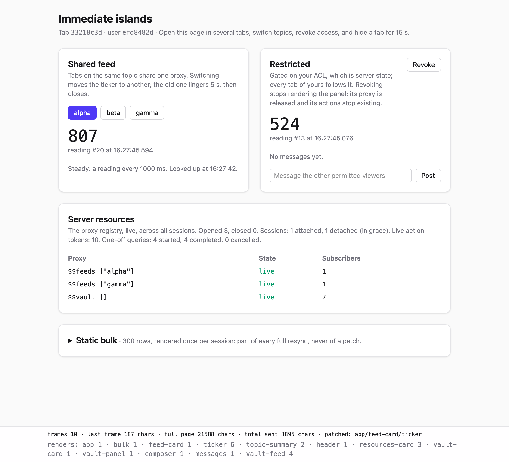

# Development

Working on Tropical itself: the tasks, the demo page, and what to know about the Java sources. Releases, the native
libraries' builds and the conventions of the code are in [`CLAUDE.md`](../CLAUDE.md), which serves people and agents
alike.

```
bb dev            # compile the Java, start the demo page with nREPL and Remontoire
bb dev:readable   # the same, with the app's names readable in the browser, for debugging
bb test           # compile the Java, run the tests
bb test:linux     # the tests in Linux, under JDK 25 in Docker: amd64, arm64, amd64-musl, arm64-musl, or all
bb lint           # clj-kondo, under the config the jar exports
bb compile:java   # after changing a .java file
bb native:zstd    # rebuild the libzstd the jar ships, from zstd's release source
bb native:brotli  # rebuild the libbrotlienc the jar ships, from brotli's release source
```

The Java sources sit next to the Clojure ones in `src`, and compile into `target/classes`.

`bb dev` serves a demo page at <http://localhost:8080>. It is not part of the library: it lives in `dev/demo`, on the
`:dev` alias only. `(user/reload!)` reloads changed Clojure code; a change to the Java needs `bb compile:java` and a
restart. The JVM also serves [Remontoire](https://github.com/multiplyco/remontoire), an MCP endpoint into it, at
<http://127.0.0.1:7888/mcp>, which Claude Code picks up from `.mcp.json`.



Open the page in two or three tabs. The footer shows each patch's size next to the full page's, which islands were
patched, and how often each has rendered. The **Server resources** card shows the subscription registry, across every
session.

1. **Share.** Two tabs on `alpha` share one subscription, opened once. A typical patch is about 190 chars against a 21 KB
   page. Within each tab, the ticker reads the feed through two hooks of its own, the reading and its label, and the
   Server resources table shows one subscriber per tab.
2. **Switch.** Pick `beta`. The ticker holds the new subscription and releases the old one, which lingers for 5 s, then
   closes. Switch back within 5 s and it is reused.
3. **Query once.** The topic summary is a 700 ms simulated query, read with `observe` like the ticker. Ticks don't
   rerun it; a new topic does. Tabs on one topic share its result, and switching back within 5 s shows it at once.
4. **Revoke.** The vault panel unmounts: its subscription lingers and closes, and its action tokens are revoked.
5. **Post.** Each message is a keyed island. A new message renders the list and the new row; the rows already shown are
   reused, and only the new one is sent, inserted before the newest. Past five, the oldest is removed by its id.
6. **Hide a tab.** Datastar closes its stream. Come back within 15 s and the page is resent from cache; stay away longer
   and the session closes, releasing what its islands held.
7. **Navigate.** "Open alpha on a page of its own" loads `/topic/alpha`, a second route: a new page and session, whose
   root comes from the route. Its ticker is the same call site with the same argument, so within 5 s it shows the
   lingering subscription at once. Close every session from the REPL, `(co.multiply.tropical.session/close-all!)`, as
   a restart would: the stream reconnects to the page's URL, and the page is rebuilt as it was.
8. **Arrive cold.** The pages wait up to 150 ms for their first frame's reads (`:first-frame-ms`). With no tab on alpha
   for 20 s, load `/topic/alpha`: its feed connects in 50 ms, so the page arrives with a reading, while the 700 ms
   summary arrives over the stream.
9. **Fold away.** The Server resources table and the vault's messages fold away, and stay as you left them: through
   the card's constant patches, across a reload, and when the panel mounts again after Revoke and Grant. The state is
   the browser's, in signals kept in a cookie, and the server renders it in the first frame (`defcookie`).
10. **Leave.** "Another topic" is an action that picks a topic on the server and opens its page. The topic route refuses
   a topic that doesn't exist: on `/topic/gamma`, remove it from the REPL,
   `(alter-var-root #'demo.state/topics dissoc "gamma")`, and close the sessions. The tab's stream reconnects, is
   refused, and the tab reloads into the not-found page.
11. **Follow.** With tabs on `/topic/alpha`, move its page from the REPL, `(demo.state/move! "alpha" "alpha-2")`. Every
   tab goes to `/topic/alpha-2`, in place of its history entry, and a page loaded at the old URL is redirected there.
   `(demo.state/move! "alpha" "alpha")` moves it back.
12. **Upload.** Pick files in the Uploads card, or drop them anywhere on the page. Each goes straight to a stand-in
   bucket at a URL the island presigned, with its progress. Once none is on its way, those that arrived are taken in
   together; a pick dropped while another is uploading joins its batch.
13. **Carry a choice.** "…with its summary hidden" opens the feed's topic on its page with the summary hidden, set by
   the action before the page loads, in its first frame. On a topic's page, Hide and Show set it for every topic's
   page, this one's at once.
14. **Notify.** "Notify my tabs" shows a toast in every tab of yours, for 6 s, a state shared on the server per user.
   "Another topic" posts one before it opens the page, and the page it opens shows it. The Server resources table
   lists the toasts' instance with a subscriber per tab.
15. **Switch tabs.** The Server resources card's Registry and Counts tabs switch in the browser, on a local signal, and
   stay as you left them while the card is patched with every change to the registry. Post is enabled while the
   message has text, from the first paint (`ui/attr`).
16. **Suggest.** Suggest answers at once, and a moment later its suggestion lands in the message, sent from a background
   task (`use-patch-signals`). Type over it: the composer renders again as the suggestion lands, or as you suggest
   again, and leaves what you typed until the next one arrives.
17. **Start over.** Click a term in the Raw HTML card, then "An example?", then another term. The definition is an
   island keyed by its term, so the new one starts with its example hidden, and goes in the old one's place: the card,
   and its passage, aren't sent.
18. **Keep a draft.** In the Drafts card, Rework a proposal, edit its sections, and pick a chip, which adds its line to
   the note. Close the dialog, reload, or restart the server: the edits are still there, kept in the browser's storage
   (`defstorage`), and the server stores none of them. Each row counts its draft's words on the server, which reads the
   draft from the browser a moment after you stop typing (`storage/observe`). Start passes the draft to its action as a
   value and drops it; Dismiss drops it while the dialog is closed. "Start, then open alpha" opens alpha's page, which
   tells of it in a toast, and drops the draft before that page loads: back on `/`, the dialog shows the proposal as
   it was.
19. **Rate.** The stars in the Rocket card are a web component made with Datastar's Rocket, `<star-rating>`. Open its
   breakdown, then rate in another tab: every tab's props change as the island is patched, and the breakdown stays
   open, a signal of the component's own. "Clear it" is the island's action, in the component's children
   ([Components with Rocket](rocket.md)).
